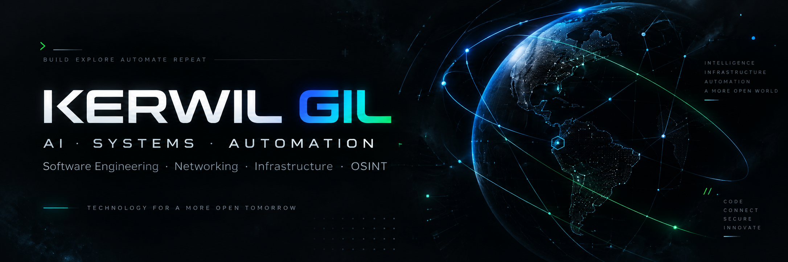

  

---

# 👋🏻 Hola, soy Kerwil Gil

**Ing. Telecomunicaciones · Lic. Gerencia de Comercio Electrónico · Master AI**

Construyo software, agentes de IA, infraestructura y automatización. Me especializo en sistemas locales-first, herramientas de diagnóstico de red, plataformas SaaS multi-tenant y soluciones de inteligencia asistida para conocimiento y contenido.

---

## 🎯 Áreas principales

| Área | Enfoque |
|------|---------|
| 🤖 **AI Engineering** | Agentes autónomos, RAG, voice AI, computer vision, LLM orchestration |
| ⚙️ **Software & Systems** | Arquitectura limpia, domain-driven design, testing riguroso, CI/CD |
| 🔄 **Automation** | n8n, workflows, bots, pipelines, task orchestration |
| 📡 **Networking & Infrastructure** | BGP/RPKI, packet analysis, diagnostics, monitoring, MikroTik, Cloudflare |
| ☁️ **SaaS / Cloud** | Multi-tenant, PostgreSQL, Redis, Stripe, Docker, self-hosted |
| 🕵️ **OSINT / Network Intelligence** | BGP looking glass, threat feeds, ASN/GeoIP, certificate transparency |

---

## 🚀 Proyectos públicos

### 🎵 [PlaylistAI](https://github.com/kerwilgil/PlaylistAI)
**Generador y analizador de playlists para Spotify mediante IA.** Convierte ideas, estados de ánimo o conceptos en listas de reproducción con canciones verificadas contra el catálogo real.

- **Stack:** Python, Flask, Spotipy / Spotify Web API, múltiples proveedores de IA.
- **Funciones:** creación y análisis de playlists, validación de artista y canción, búsquedas concurrentes y ejecución local.
- **Versión documentada:** **v1.1.1** · [Código fuente](https://github.com/kerwilgil/PlaylistAI) · [Descargar versión 1.1.1](https://github.com/kerwilgil/PlaylistAI/releases/tag/v1.1.1).

### 💰 [Moneta Lite](https://github.com/kerwilgil/moneta-lite)
**Gestor de finanzas personales self-hosted y de código abierto.** Administra cuentas, movimientos, facturas, tarjetas y suscripciones sin depender de una plataforma SaaS.

- **Stack:** Python, Django 6, SQLite / PostgreSQL.
- **Funciones:** panel financiero, reportes, cola de importaciones con deduplicación y servidor MCP para agentes con aprobación humana.
- **Versión documentada:** **v0.3.0** · [Código y documentación](https://github.com/kerwilgil/moneta-lite).

### 🎬 [DaVinci Resolve MCP](https://github.com/kerwilgil/davinci-resolve-mcp)
**Servidor MCP para automatizar DaVinci Resolve** mediante herramientas estructuradas, sin depender de clics o automatización visual de la interfaz.

- **Stack:** Python, Model Context Protocol (MCP), API de DaVinci Resolve.
- **Funciones:** inspección de proyectos, edición de timelines, gestión de medios, operaciones de color y renders.
- **Enfoque:** ejecución local, separación de lectura/escritura y pruebas automatizadas.

### 🧹 [Cowork Session Cleaner](https://github.com/kerwilgil/cowork-session-cleaner)
**Utilidad multiplataforma para administrar sesiones locales de Claude Cowork.**

- **Stack:** Python.
- **Funciones:** listar, archivar, restaurar y eliminar sesiones; vista previa de cambios (*dry-run*).
- **Plataformas:** Windows y macOS; funciona sin dependencias externas.

---

## 🤝 Contribuciones a proyectos open source

Algunos **pull requests que propuse y que fueron integrados** en proyectos de terceros:

| Proyecto | Contribución | Resultado |
|---|---|---|
| **OpenMausBot** | [#2405 — Portapapeles fiable en escritorio local y remoto](https://github.com/milind-soni/OpenMausBot/pull/2405) | ✅ Merged |
| **Argos-Auditor** | [#1 — Correcciones a Codex, referencias de skills y seguridad](https://github.com/joseabrer/Argos-Auditor/pull/1) | ✅ Merged |
| **Argos-Auditor** | [#2 — Detección de Claude Code y límite de tamaño del prompt](https://github.com/joseabrer/Argos-Auditor/pull/2) | ✅ Merged |

[Ver todos mis pull requests](https://github.com/search?q=is%3Apr+author%3Akerwilgil&type=pullrequests) · [Ver PR en los que he participado](https://github.com/search?q=is%3Apr+involves%3Akerwilgil&type=pullrequests)

---

## 🧪 Proyectos en desarrollo y privados

- **🔴 MARTE:** agente y framework de IA en desarrollo. **No se presenta como producto terminado ni release público estable.**
- **🤖 VIERNES:** agente personal de IA para automatización e interacción con el equipo. **Proyecto de uso privado; sin distribución pública de la versión 1.0.**

Estos proyectos se mencionan únicamente como líneas de trabajo; no hay enlaces a entregas pendientes.

---

## 🛠️ Stack tecnológico

> Tecnologías con las que trabajo. No todas forman parte de los proyectos públicos destacados.

### Lenguajes & Runtimes

### Frameworks & Librerías

### Datos & Infraestructura

### Networking & Sistemas

### CI/CD & Automatización

---

## 📊 GitHub Analytics

  
  

> *Nota: Las tarjetas dependen de un servicio externo (vercel.app) que puede estar temporalmente no disponible. Si no se visualizan, el servicio está caído y se restaurará automáticamente.*

---

  Software práctico · IA, automatización, redes e infraestructura · Local-first cuando aporta privacidad y control

